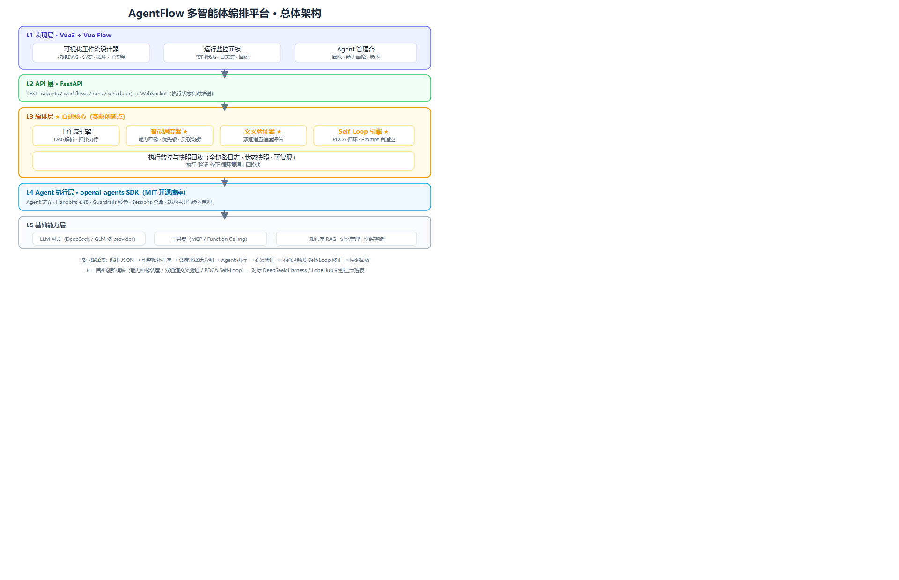

# AgentFlow — 多智能体编排调度平台

> 第五届"未来杯"创新大赛 · 赛题一（Agent 编排创新应用）
> 面向多智能体协作的「编排-调度-执行-验证」一体化平台

**评审复现指南**：[REPRODUCTION.md](./REPRODUCTION.md)（10 分钟从零部署+体验+数据复现）



## 项目简介

AgentFlow 是一个可视化的多智能体编排调度平台，对标 DeepSeek Harness / LobeHub 等主流 Agent Harness 框架，重点解决产业三大痛点：

| 行业痛点 | AgentFlow 方案 |
|---|---|
| 编排能力薄弱（脚本化硬编码） | 可视化 DAG 工作流设计器：顺序/并行/条件分支/循环/子流程 |
| 调度策略单一（串行/广播） | **能力画像动态调度**：成功率/耗时/成本/负载四维画像 + 负载均衡 |
| 验证与可信机制缺失 | **双Agent交叉验证** + 置信度评估 + **PDCA Self-Loop** 自动修正 |

## 核心功能

1. **Agent 团队定义与管理** — 角色/技能/工具集/记忆配置，动态注册、版本管理（基于 openai-agents SDK）
2. **可视化工作流编排** — 拖拽式 DAG 编辑器（Vue Flow）：节点库拖入、连线、删除、点击配置，用户可完全自定义工作流
3. **AI 自适应工作流生成** ★ — 用一句话描述业务需求，LLM 自动设计 Agent 团队 + 工作流 DAG（含验证节点、条件分支与修正循环），平台自我适配新场景
4. **智能调度引擎** ★ — 能力画像加权评分（成功率 0.5 / 耗时 0.2 / 成本 0.1 / 负载 0.2）+ 并发上限路由
5. **执行监控与结果验证** ★ — 生成者-评审者双通道交叉验证（LLM 评审 0.7 + 确定性规则 0.3），全链路日志、状态快照、可回放
6. **反馈与自我优化** ★ — 双层循环：节点内 PDCA Self-Loop（≤3轮）+ 工作流级修正循环（max_visits 控制，变化驱动重跑）
7. **工具与外部系统集成** — 双协议工具注册中心：Function Calling（联网搜索、AI图像生成、文件产出、字数统计）+ MCP（自研 MCP Server 科学计算器）
8. **多模态文件产出** ★ — AI 图像生成（多模型调度：豆包Seedream/GLM CogView/Pollinations 免费兜底，自动入库）+ 表格CSV/文档MD/网页HTML 文件产出，前端 Markdown 渲染真实图片与表格、文件库一键下载
9. **知识库定义与集成（RAG）** — jieba 分词 + TF-IDF 向量 + 余弦检索，Agent 执行时自动检索注入上下文
10. **多工作流管理** — 4 个内置场景模板（内容生产/数据分析/市场调研/公众号成品）+ 用户自定义工作流持久化
11. **零内置 API Key** — 7 家国产大模型接入模板（DeepSeek/GLM/豆包/Kimi/通义/文心/MiniMax），key 全部由用户在界面填入

> ★ 为自研创新模块（赛题考察重点），其余基于开源组件封装。

## 技术架构

```
┌─ 表现层   Vue3 + Vue Flow（可视化编排器 / 监控面板 / Agent管理台）
├─ API层    FastAPI（REST + WebSocket 实时事件流）
├─ 编排层★  工作流引擎 / 能力画像调度器 / 交叉验证器 / Self-Loop引擎 / 快照回放
├─ 执行层   openai-agents SDK（Agent/Handoffs/Guardrails/Sessions）
└─ 基础层   LLM网关(DeepSeek/GLM) / 工具集(MCP/Function Calling) / 快照存储
```

## 快速开始

### 环境要求

- Python 3.11+，Node.js 18+
- DeepSeek API Key（或任意 OpenAI 兼容接口）

### 后端

```bash
cd backend
python3 -m venv venv
./venv/bin/pip install -r requirements.txt
# 配置 LLM key（环境变量或 ~/.hermes/.env）
export DEEPSEEK_API_KEY=sk-xxx
export DEEPSEEK_BASE_URL=https://api.deepseek.com
./venv/bin/uvicorn app.main:app --host 127.0.0.1 --port 8900
```

### 前端

```bash
cd frontend
npm install
npm run dev        # http://127.0.0.1:5173（已配置 /api 与 /ws 代理）
```

### 端到端验证

```bash
cd backend && ../venv/bin/python test_e2e.py     # 直接跑通内容生产管线
cd .. && ./venv/bin/python scripts/benchmark.py  # 三种调度策略对比基准测试
```

## Demo 场景：多Agent智能内容生产管线

```
[选题策划] → [大纲生成] → ┌[正文撰写]─┐
                          │  (并行)   │ → [独立审核] → [条件分流] ─┬─ ≥7分 → [排版发布]
                          └[配图提示]─┘            │              └─ <7分 → [润色修订] → [排版发布]
                                                   └── 撰写节点内置 交叉验证 + Self-Loop
```

- 正文撰写角色注册了 2 个候选实例（deepseek 资深 / glm 实习），由能力画像调度器择优分配
- 实测：润色节点经 4 轮 Self-Loop 修正，验证分 4.4 → 9.3 通过阈值

## 性能对比（scripts/benchmark.py 实测，6 个撰写任务）

| 调度策略 | 总耗时 | 平均耗时/任务 | 成功率 | 平均验证分 | 备注 |
|---|---|---|---|---|---|
| 单 Agent 串行（基线1） | 32.0s | 4.1s | 100% | 8.83 | 赛题指定基线 |
| 轮询调度（基线2） | 51.0s | 8.5s | 100% | 8.48 | 一半任务分给慢实例 |
| **能力画像调度（实验组）** | **34.1s** | **4.4s** | **100%** | **8.60** | 自动识别最优候选 |

**结论**：能力画像调度相比轮询调度总耗时降低 33%（51.0s → 34.1s），并保持与单 Agent 串行（理论最优固定选优）几乎持平的耗时（+6.6%），验证了画像学习机制能在"无先验知识"下自动收敛到最优分配。

**并发负载测试**（8 任务并发，4 线程池）：并发 16.2s vs 串行 45.3s，加速 **2.8x**，峰值负载 4，通过率 100%。任务自动分流：writer-a 满负载时调度器路由到次优的 writer-b，验证了负载均衡能力。

> 详细逐任务数据见 data/benchmark.json

## 目录结构

```
agentflow/
├── backend/
│   ├── app/
│   │   ├── main.py            # FastAPI 入口（REST + WebSocket）
│   │   ├── llm.py             # LLM 网关（多 provider）
│   │   ├── models.py          # Pydantic 数据模型
│   │   ├── agents/            # Agent 工厂 / 注册表 / 能力画像
│   │   ├── core/              # ★ 自研核心
│   │   │   ├── engine.py      #   工作流引擎（DAG 执行器）
│   │   │   ├── scheduler.py   #   能力画像调度器 ★
│   │   │   ├── verifier.py    #   交叉验证器 ★
│   │   │   └── loop.py        #   Self-Loop 引擎 ★
│   │   ├── workflows/         # 场景工作流（内容生产管线）
│   │   ├── tools/             # 工具注册中心（Function Calling + MCP Server）
│   │   ├── rag/               # 知识库（TF-IDF 向量检索）
│   │   └── store.py           # 运行快照存档（可回放）
│   ├── test_e2e.py            # 端到端测试（含工具+知识库）
│   ├── test_features.py       # 工具/MCP/知识库单项验证
│   └── data/                  # 运行快照 + 基准数据 + 知识库文档
├── frontend/                  # Vue3 + Vue Flow
└── scripts/
    ├── benchmark.py           # 调度策略对比基准测试
    └── test_providers.py      # LLM provider 可用性测试
```

## 开源合规说明

本项目基于以下开源组件二次开发（均遵守其开源协议）：

- [openai-agents-python](https://github.com/openai/openai-agents-python)（MIT）— Agent 执行层底座，使用其 Agent/Runner/Guardrails 抽象
- Vue3 / Vue Flow / FastAPI（MIT）— 前端与 API 框架

**自定义改进点**（非默认示例）：能力画像调度器、双通道交叉验证器、PDCA Self-Loop 引擎、可视化 DAG 编排器、运行快照回放，全部为本项目原创实现。
